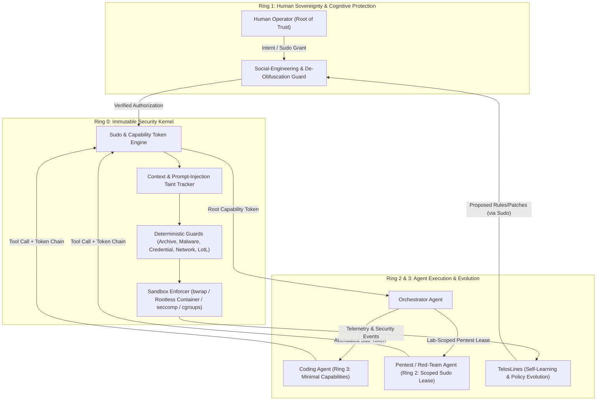

# ActiveSecHarness

**An adaptive, open-source coding harness with an active security architecture (`sudo`-inspired capability chains, deterministic Ring-0 interceptors, component security testing, and self-evolving defense via TelosLines).**

---

## 1. Core Philosophy: "Living off the Land" (LotL) & Active Immune Defense

By design, an AI coding harness possesses the exact primitives an attacker uses after initial compromise for **Living off the Land (LotL)**:
- Arbitrary shell execution (`bash`, `python`, `curl`, `git`, `openssl`, `tar`)
- Direct read/write access to the filesystem
- Outbound and local network access
- Exposure to environment variables, SSH sockets, API keys, and system configurations

### Why Traditional Approaches Fail
1. **Static Restriction ("Block Everything"):** Renders the harness useless for real-world software engineering, system administration, and offensive/defensive cybersecurity research (penetration testing). Furthermore, static blocklists decay rapidly against novel attack vectors.
2. **Blind Delegation ("YOLO Mode" or Naive Prompting):** Either exposes the host to immediate compromise via indirect prompt injection or induces *Approval Fatigue*, making the human operator vulnerable to social engineering.

### The ActiveSecHarness Approach
**ActiveSecHarness** explicitly treats itself as a primary attack surface (LotL risk) while simultaneously serving as the dynamic instrument to discover, verify, and patch new vulnerabilities:

1. **Security by Design (Deterministic Ring-0 Baseline):** Known attack vectors are intercepted deterministically at the kernel/interceptor layer (Ring 0) before execution—including decompression bombs (ZipBombs), path traversal (Zip-Slip), malware/polyglots (quarantine AV/YARA scanning), insecure network transport, weak passwords (entropy + dictionary/mutation attack defense), and unsafe sandbox configurations.
2. **The `sudo` Principle & Cryptographic Capability Chains:** In principle, *anything* is possible within the harness (including offensive penetration testing inside isolated target labs or system-level actions), **but nothing is permitted implicitly or globally across all agents**. All authority originates from the human user (*Root of Trust*). Automated delegation to sub-agents requires cryptographically signed, time-bound, and strictly scoped **Capability Chains** with monotonic *Attenuation* (permissions can only be narrowed down the chain, never expanded) and continuous per-call verification.
3. **Human Protection Against Social Engineering:** Because the human user is a critical attack vector (e.g., via trojanized issues, copy-paste traps, or obfuscated commands), an independent, context-isolated *Cognitive & De-Obfuscation Guard* protects the operator during `sudo` ceremonies.
4. **Open Source as a Security Guarantee:** No *Security through Obscurity*. Every guard, policy engine, capability verifier, and wiki security assessment is open-source, deterministic, and continuously audited.
5. **Evolution via TelosLines & Dedicated Red-Teaming:** The harness provides the foundation for **TelosLines** and specialized security models (free from artificial refusal bottlenecks, safely contained by Ring-0 sandboxes) so the system continuously learns from attack traces and hardens itself.

---

## 2. System Architecture Overview

---

## 3. Repository Documentation & Karpathy LLM Wiki

ActiveSecHarness maintains both architectural specifications (`docs/`) and a self-updating **Karpathy-style Security Wiki (`wiki/`)** that tracks the real-time security posture, threat coverage, and adversarial test results of every single component.

| Path | Purpose & Scope |
| :--- | :--- |
| **[`docs/01_threat_taxonomy.md`](docs/01_threat_taxonomy.md)** | **Threat Taxonomy:** Comprehensive classification across 6 domains (A: LotL / Tool Misuse, B: Artifact/Archive Vectors incl. ZipBombs & Malware, C: Network & Supply Chain, D: Passwords/Dictionary Attacks & Secrets, E: Sandbox Isolation, F: Human Social Engineering & AI Prompt Injection). |
| **[`docs/02_sudo_capability_architecture.md`](docs/02_sudo_capability_architecture.md)** | **`sudo` & Capability Architecture:** Privilege Rings (Ring 0–3), cryptographic capability tokens, monotonic attenuation rules, zero-trust per-call verification, and the *Explain-Before-Sudo* social-engineering defense. |
| **[`docs/03_deterministic_guards_spec.md`](docs/03_deterministic_guards_spec.md)** | **Deterministic Security Gateways:** Technical specifications for `ArchiveGuard`, `MalwareGuard`, `CredentialGuard`, `NetworkGuard`, and `SandboxGuard`. |
| **[`docs/04_model_and_evolution_roadmap.md`](docs/04_model_and_evolution_roadmap.md)** | **Base Harness, Model Strategy & TelosLines Roadmap:** Minimal Python core architecture (`mini-swe-agent` style), multi-model routing for penetration testing without refusal bottlenecks, and the TelosLines self-learning interface. |
| **[`wiki/INDEX.md`](wiki/INDEX.md)** | **Karpathy Security Wiki Root:** Living knowledge base compiled and updated automatically from component security docstrings and dedicated security test suites. |
| **[`wiki/SECURITY_LEDGER.md`](wiki/SECURITY_LEDGER.md)** | **Automated Component Security Ledger:** Live matrix of all components, their risk ratings, mitigated attack vectors, and latest adversarial test verification status. |

---

## 4. Engineering Discipline & Automated Verification

1. **Object-Oriented, Pythonic, Safe by Construction:** Strict type annotations (`mypy --strict`), immutable state objects (`@dataclass(frozen=True)`), explicit custom exception hierarchies, and Resource-Acquisition-Is-Initialization (RAII) context managers.
2. **Mandatory Component Security Tests:** No component is complete without a dedicated adversarial security test suite (`tests/security/test_sec_<component>.py`) that actively attacks the component's threat vectors.
3. **Automated Wiki Synchronization:** Running `python3 tools/wiki_sync.py` executes the security test suites, inspects component security contracts, and automatically updates `wiki/SECURITY_LEDGER.md`, `wiki/components/*.md`, and `wiki/log.md`.
4. **Atomic English Git Workflow:** Every logical change is committed atomically in English with structured security-impact commit messages.
