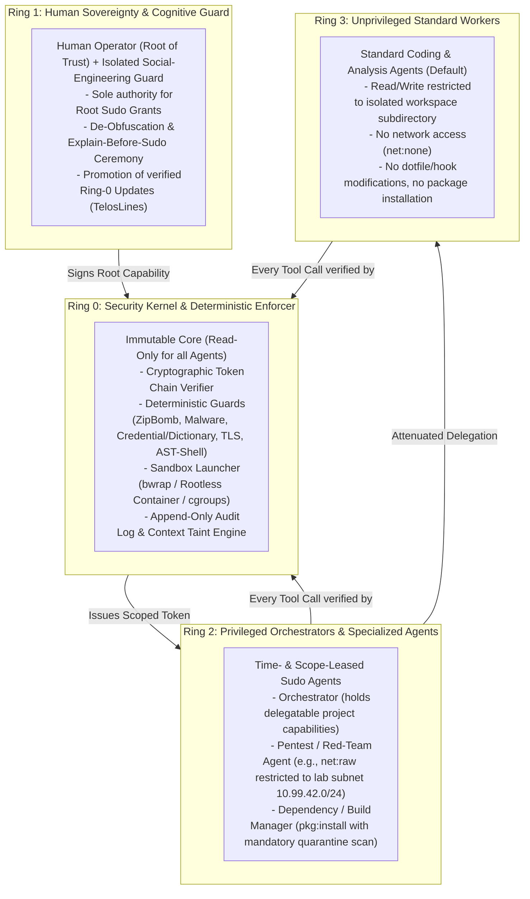
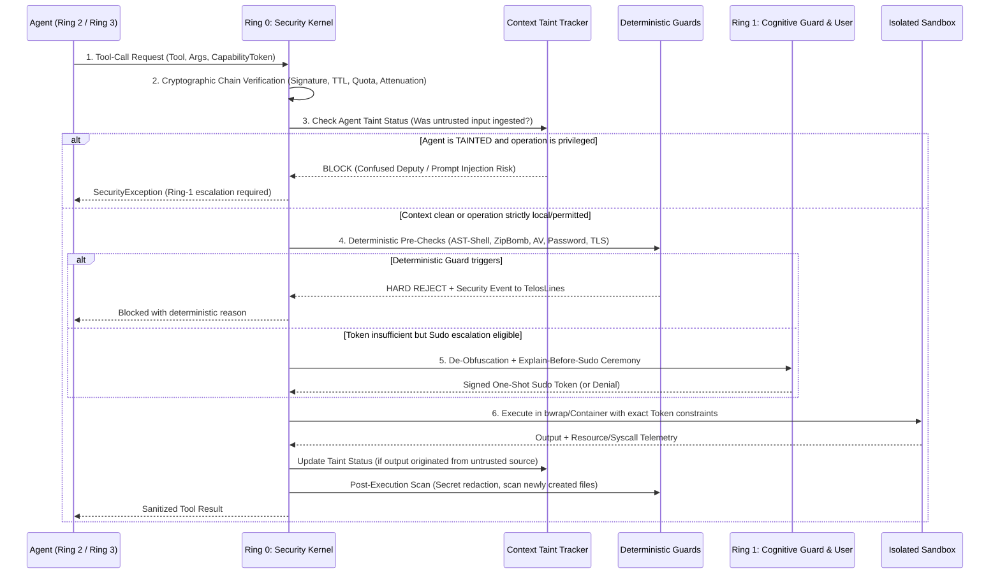

# 02 – `sudo` & Capability Chain Architecture (Delegation & Continuous Verification)

This document specifies the authorization, delegation, and verification model of **ActiveSecHarness**.

---

## 1. Why a `sudo` Architecture for AI Agents?

An active cybersecurity coding harness faces a fundamental dilemma:
- **Too Restrictive:** Globally blocking tools like network scanners (`nmap`), raw sockets, container runtimes, package managers, or exploit verification scripts prevents the harness from building complex software or performing penetration testing.
- **Too Permissive:** Running every agent with full user privileges means a single indirect prompt injection or hallucinated command can compromise the host.

### The Solution: Linux `sudo` Evolved into Cryptographic Capability Chains
Following the Unix `sudo` philosophy:
1. **In principle, anything is possible**, provided the human user (*Root of Trust*) authorizes it.
2. **No agent runs as "root" by default.** Every agent starts in an unprivileged baseline (Ring 3).
3. **Permissions are explicit, purpose-bound, time-limited, and continuously verified.**
4. **Automated delegation to sub-agents enforces a strict cryptographic Capability Chain:** An agent can never delegate more authority than it holds, and every delegation step narrows the scope (*Monotonic Attenuation*).

---

## 2. The 4-Ring Privilege Model (Ring 0 to Ring 3)

ActiveSecHarness isolates responsibilities across four concentric privilege rings:



| Ring | Name | Typical Actors | Write Access to Harness/Policies? | Default Network |
| :--- | :--- | :--- | :--- | :--- |
| **Ring 0** | **Security Kernel** | Deterministic Interceptors, Token Verifier, Sandbox Spawner | No (Immutable at runtime) | Controls all sockets |
| **Ring 1** | **Sovereign / Human** | Human Operator + isolated *Social-Engineering Guard* | **Yes** (sole authority via explicit `sudo` ceremony) | Full sovereignty |
| **Ring 2** | **Scoped Sudo Agents** | Orchestrator, Pentest Agent, Security Patch Agent | No | Explicitly leased scopes only (e.g., Lab container) |
| **Ring 3** | **Unprivileged Workers** | Code Editor Agent, Test Runner, Documentation Agent | No (workspace files only; dotfiles/hooks blocked) | `net:none` (Offline) |

---

## 3. Cryptographic Capability Tokens & Monotonic Attenuation

Permissions in ActiveSecHarness are represented as **cryptographically signed Capability Tokens** (inspired by *Macaroons* / *Biscuit Tokens* using HMAC-SHA256 / Ed25519 signatures).

The signing keys reside exclusively in the **Ring-0 Kernel** (and Ring-1 user keystore). Agents cannot forge tokens or strip existing restrictions (*Caveats*).

### 3.1 Capability Token Data Model

```python
from dataclasses import dataclass
from typing import FrozenSet, Optional, Tuple

@dataclass(frozen=True)
class CapabilityCaveat:
    """An immutable constraint block that must hold true for every tool invocation."""
    allowed_tools: FrozenSet[str]            # e.g., frozenset({"fs:read", "fs:write", "shell:exec"})
    path_prefixes: Tuple[str, ...]           # e.g., ("/workspace/src/",)
    denied_paths: Tuple[str, ...]            # e.g., (".git/hooks", ".env", ".ssh")
    allowed_binaries: FrozenSet[str]         # e.g., frozenset({"pytest", "git", "python3"})
    network_destinations: FrozenSet[str]     # e.g., frozenset() or frozenset({"10.99.42.2:8080/tcp"})
    max_calls_remaining: int                 # e.g., 10 invocations
    expires_at_unix: float                   # Strict Time-To-Live (TTL)
    require_untainted_context: bool = True   # Immediately blocks if prompt-injection taint is active

@dataclass(frozen=True)
class CapabilityToken:
    token_id: str
    parent_token_id: Optional[str]           # Cryptographic link to parent token in chain
    issuer_ring: int                         # 1 (Human) or 2 (Orchestrator)
    subject_agent_id: str                    # Bound to a specific agent instance
    task_purpose: str                        # Explicit purpose for audit & intent verification
    caveats: Tuple[CapabilityCaveat, ...]    # Conjunction (AND) of all caveats in the lineage
    signature: str                           # HMAC-SHA256 / Ed25519 signature over the entire chain
```

### 3.2 The Law of Monotonic Attenuation

When a Ring-2 Orchestrator delegates a subtask to a sub-agent, it appends a new `CapabilityCaveat` to its token and requests a child token from the Ring-0 Kernel.

The Kernel mathematically enforces for every dimension:

\[
\text{Scope}(\text{Token}_{\text{Child}}) \subseteq \text{Scope}(\text{Token}_{\text{Parent}})
\]

Specifically:
- **Tools:** \(\text{Tools}_{\text{Child}} \subseteq \text{Tools}_{\text{Parent}}\)
- **Filesystem Paths:** Every prefix in \(\text{Paths}_{\text{Child}}\) must be a canonical subpath of \(\text{Paths}_{\text{Parent}}\).
- **Network Destinations:** \(\text{Net}_{\text{Child}} \subseteq \text{Net}_{\text{Parent}}\)
- **Expiration (TTL):** \(\text{Expires}_{\text{Child}} \le \text{Expires}_{\text{Parent}}\)
- **Call Quota:** \(\text{MaxCalls}_{\text{Child}} \le \text{MaxCalls}_{\text{Parent}}\)

**Security Guarantee:** Even if a sub-agent is completely hijacked via prompt injection, it is mathematically confined to the narrow intersection of its attenuated sub-token.

---

## 4. Continuous Zero-Trust Verification on Every Tool Call

A capability chain is insufficient if checked only at agent startup. Because system state and context taint evolve with every step, **every single tool call** passes through a 6-stage verification pipeline in Ring 0:



---

## 5. Protecting the Human Operator Against Social Engineering ("Explain-Before-Sudo")

Because all authority originates from the human user, the operator is the highest-value target for social engineering. ActiveSecHarness interposes the **Cognitive & Social-Engineering Guard (Ring 1)** between any privilege request and the user's decision:

1. **Context Isolation of the Risk Explainer:** The agent requesting `sudo` never writes the security prompt shown to the user. Instead, an isolated verifier inspects only the canonicalized command and real filesystem/network diff.
2. **Mandatory De-Obfuscation (What You See Is What Executes):** Ring 0 automatically decodes Base64/Hex strings, expands shell variables, resolves symlinks, inlines the diff of any script being invoked, and flags invisible Unicode control characters.
3. **Consequence Framing & Friction Scaling:**
   - **Level 1 (Low Risk – Local/Reversible):** Compact scope preview, single confirmation with automatic TTL.
   - **Level 2 (Medium Risk – External Interaction):** Displays package age, CVE status, domain reputation, and full file diff.
   - **Level 3 (High Risk – System Action / Pentest Lease):** Anti-reflex barrier. The user must explicitly type the target scope (e.g., `allow-pentest 10.99.42.0/24`).
   - **Level 4 (Critical – Social-Engineering Pattern / Ring-0 Tampering):** Hard block by default (`curl | sh`, reading `~/.ssh`, disabling guards).

---

## 6. Dedicated Capability Chains for Penetration Testing

To enable active vulnerability research and penetration testing without endangering the host or external networks, ActiveSecHarness implements the **`PentestCapabilityChain`**:

1. **Ephemeral Target Lab:** The target application is launched inside an isolated virtual network namespace (`10.99.42.0/24`) with no route to the public internet or host LAN.
2. **Cryptographic Target Binding:** The pentest agent's token restricts `network_destinations` exclusively to `10.99.42.0/24`. Kernel-level network namespaces make packet leakage outside the lab physically impossible.
3. **Unrestricted Security Reasoning Inside the Cage:** Within this cryptographically and network-isolated lab scope, specialized (uncensored) security models can execute offensive payloads, verify exploits, and synthesize patches.
4. **Instant Revocation Kill-Switch:** Revoking the root token immediately terminates all child tokens and kills the associated `cgroups` process tree.
