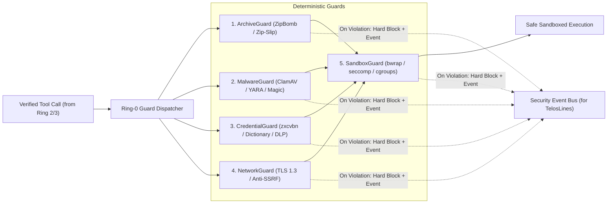

# 03 – Technical Specification of Deterministic Security Guards (Ring 0)

This document specifies the five deterministic Ring-0 security gateways in **ActiveSecHarness**.

## Core Principle: Deterministic Enforcement Before AI Judgment

Large language models excel at contextual reasoning and synthesizing novel defenses, but they are probabilistic and susceptible to prompt injection.

Physical and mathematical security invariants (Is this archive a decompression bomb? Does this file match a malware signature? Is this password vulnerable to dictionary/mutation attacks? Is this TLS connection verified? Is this subprocess confined to its namespace?) must **never** be delegated to an LLM. They are enforced deterministically by **Ring-0 code modules**.

---

## Ring-0 Guard Pipeline Architecture

---

## 1. `ArchiveGuard`: Defense Against ZipBombs, TarBombs & Path Traversal

### 1.1 Threat Scenario
- An adversary or compromised package supplies a small archive (`42.zip`, `zbsm.zip`, `.tar.gz`, `.whl`) that expands to gigabytes or petabytes (RAM/Disk exhaustion).
- **Crucial detail:** Archive headers (`uncompressed_size`) can be trivially forged. Inspecting headers alone before calling `extractall()` is insecure.
- Archives may also contain traversal paths (`../../.bashrc`) or malicious symlinks/device nodes.

### 1.2 Technical Specification & Algorithm
1. **Interception of Shell Unpackers:** Direct shell calls to `unzip`, `tar`, `gunzip`, or `7z` are intercepted and routed through `ArchiveGuard`.
2. **Two-Stage Validation (Header Pre-Check + Streaming Byte Counter):**
   - **Stage A (Metadata Check):** Validate entry count (`max_file_count = 10_000`) and file mode attributes (rejecting symlinks, FIFOs, and device nodes).
   - **Stage B (Chunked Streaming Decompression):** Decompress each entry in 64 KB chunks while tracking *actual decompressed bytes* against compressed sizes and total archive quotas.
   - **Canonical Path Verification:** Resolve every target path via `os.path.realpath` and enforce containment within the quarantine directory.

---

## 2. `MalwareGuard`: Automated Antivirus, YARA & File Integrity Scanning

### 2.1 Threat Scenario
- Ingressed files, unpacked archives, or build artifacts contain malware, trojans, reverse-shell scripts, or polyglot files (e.g., an image `logo.png` that is also an executable script or ELF binary).

### 2.2 Technical Specification & Quarantine Workflow
1. **Mandatory Quarantine Staging:**
   - All external files land first in an isolated quarantine directory mounted with `noexec,nosuid,nodev`.
2. **Three-Stage Verification Pipeline:**
   - **Stage 1: Magic-Byte vs. Extension Verification (`libmagic`):** Blocks files whose magic header (e.g., `\x7fELF`, `MZ`, `#!/`) contradicts a benign extension (`.png`, `.txt`, `.json`, `.md`).
   - **Stage 2: Antivirus Daemon Scan (`ClamAV` / `clamd`):** Streams file contents to the local ClamAV socket and checks SHA-256 malware hash feeds.
   - **Stage 3: YARA Rule Engine:** Scans text, script, and binary files for obfuscated execution chains (`eval(base64.b64decode(...))`), reverse-shell primitives, prompt-injection markers, and Trojan Source Unicode Bidi characters (`U+202A`–`U+202E`, `U+2066`–`U+2069`).

---

## 3. `CredentialGuard`: Password Strength, Dictionary Attack Defense & Secret DLP

### 3.1 Threat Scenario
1. **Weak Passwords:** Agents or users configure passwords/passphrases vulnerable to dictionary attacks, rule-based mangling (Leet-speak, year suffixes), or credential stuffing.
2. **Secret Leakage:** Cleartext API keys or private keys leak into source files, Git commits, or external LLM prompts.

### 3.2 Technical Specification: Password & Dictionary Verification
Every operation that defines or validates a password, passphrase, or secret key must pass `CredentialGuard`:

1. **No LLM-Invented Randomness:** Models must never generate secrets in text; they must invoke the deterministic CSPRNG tool (`secrets.token_urlsafe` / `os.urandom`).
2. **Stage 1: Structural & Entropy Evaluation (`zxcvbn` patterns):** Detects keyboard walks (`qwerty`), sequences (`12345`), repeated substrings, dates, and common substitutions, enforcing $\ge 80$ bits of effective entropy (Score 4/4).
3. **Stage 2: De-Mangling & Dictionary Attack Defense:**
   - **Reverse Cracker Normalization (De-Mangling):** Strips leading/trailing digits and symbols (`Summer2026!!` $\rightarrow$ `summer`), reverses Leet-speak substitutions (`0->o, 1->i/l, 3->e, 4->a, 5->s, 7->t, @->a, $->s`), and splits CamelCase/passphrase tokens.
   - **Dictionary & Context Matching:** Checks normalized tokens against local dictionary Bloom filters/wordlists (common passwords, English/German dictionaries) **plus dynamic project-context tokens** (repository name, username, domain names) so passwords like `ActiveSec2026!` or `S1m0n_Admin!` are deterministically rejected.

### 3.3 Technical Specification: Bidirectional Secret Redaction (DLP)
- **Ingress Redaction (File/Stdout $\rightarrow$ Agent):** Regex + Shannon-entropy scanner replaces PEM private keys, API tokens (`sk-...`, `ghp_...`, `AKIA...`), JWTs, and `.env` secrets with `<SECRET_REF:sha256_8chars>` before text enters the LLM context.
- **Egress Gate (Agent $\rightarrow$ File/Git/Network):** Blocks writing cleartext secrets to tracked files or outbound network requests.

---

## 4. `NetworkGuard`: Secure Transport (TLS 1.3) & Anti-SSRF/Exfiltration

### 4.1 Threat Scenario
- Insecure cleartext HTTP connections, disabled TLS certificate validation, SSRF against `127.0.0.1` or cloud metadata (`169.254.169.254`), DNS rebinding, or covert data exfiltration.

### 4.2 Technical Specification
1. **Offline by Default (`net:none`):** Ring-3 processes run with `--unshare-net` (isolated loopback only).
2. **Verified Egress Gateway:**
   - Enforces `https://` with **TLS 1.3** (minimum strong AEAD TLS 1.2), `ssl.CERT_REQUIRED`, and `check_hostname = True`.
   - **Socket-Level IP Validator (Anti-SSRF & Anti-DNS-Rebinding):** Resolves DNS once, validates every returned IP via Python `ipaddress` (blocking loopback, private RFC1918, link-local `169.254.0.0/16`, multicast, and reserved ranges), and connects directly to the verified IP with proper TLS SNI.
   - Localhost or lab subnet connections (`10.99.42.0/24`) are permitted **only** when explicitly listed in the verified `CapabilityToken.network_destinations`.

---

## 5. `SandboxGuard`: Process, Namespace & Resource Isolation

### 5.1 Threat Scenario
- A subprocess attempts to read outside the workspace (`~/.ssh`, `/etc/shadow`), launch a fork bomb, or escape the container environment.

### 5.2 Technical Specification (Linux Security Stack)
Every subprocess spawned by the harness is wrapped by `SandboxGuard`:

1. **Namespace & Filesystem Isolation (`bubblewrap` / `bwrap`):**
   - `--unshare-all`, `--die-with-parent`, `--new-session`.
   - Read-only system mounts (`/usr`, `/lib`, `/bin`).
   - Writable bind-mount restricted strictly to the token's allowed workspace subdirectory, with sensitive paths (`.git/hooks`, `.env`) over-mounted as `read-only` or empty `tmpfs`.
   - The user's real home directory (`/home/<user>`) is completely unmounted and invisible inside the sandbox.
2. **Resource Quotas (`cgroups v2` / `prlimit`):**
   - `RLIMIT_NPROC` / `pids.max = 64` (instant fork-bomb mitigation).
   - `RLIMIT_AS` / `memory.max = 2G` and `RLIMIT_FSIZE = 100M`.
   - Hard wall-clock timeout with process-group `SIGKILL`.
3. **Syscall Filtering (`seccomp-bpf`):** Blocks dangerous kernel syscalls (`ptrace`, `kexec_load`, `mount`, `bpf`, `perf_event_open`, `userfaultfd`, `keyctl`).
