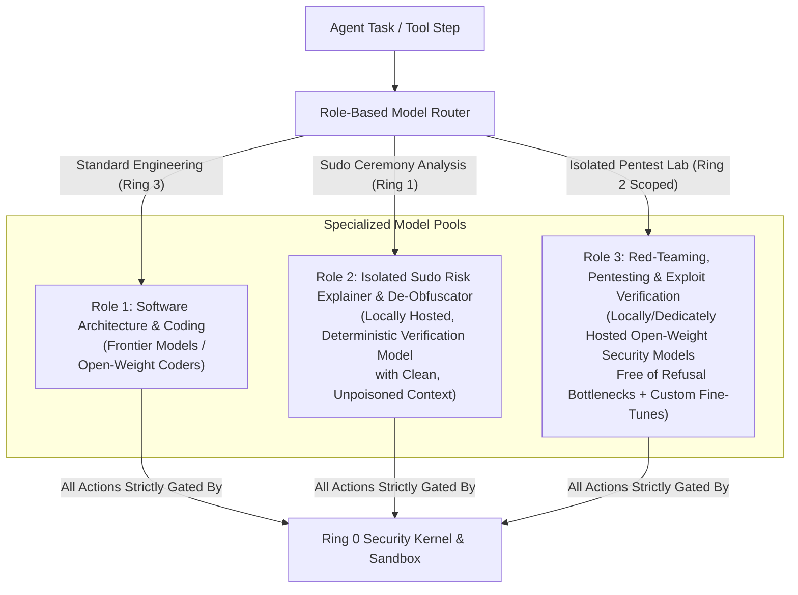
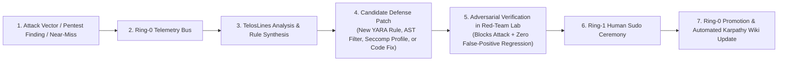

# 04 – Base Harness, Model Strategy (Pentesting & Refusals) & TelosLines Evolution

This document outlines the minimal Python base harness architecture, our multi-model routing strategy to overcome commercial AI safety refusals during legitimate cybersecurity work, and the integration of **TelosLines** for continuous self-hardening.

---

## 1. Lightweight Python Base Harness Architecture

### 1.1 Why a Minimal Trusted Computing Base (TCB) Is Essential
Large, monolithic agent frameworks with tens of thousands of lines of code and opaque plugin abstractions violate the security principle of **auditability**:
- In sprawling codebases, *Living-off-the-Land* bypasses (such as an unguarded `subprocess.Popen` call in a utility module) easily go unnoticed.
- A compact, object-oriented, strictly typed Python core guarantees that **100% of all tool executions pass through the Ring-0 `SecurityKernel`**.

### 1.2 Architectural Blueprint (`mini-swe-agent` Inspired Core + Ring-0 Kernel)

```text
ActiveSecHarness/
├── README.md
├── AGENTS.md                         # Engineering & Security Rules for Humans and AI Agents
├── .cursor/rules/                    # Automated Cursor IDE Enforcement Rules
├── docs/                             # Architectural Specifications (01 - 04)
├── wiki/                             # Self-Updating Karpathy LLM Security Wiki
│   ├── INDEX.md                      # Wiki Knowledge Graph Entry Point
│   ├── SECURITY_LEDGER.md            # Live Component Risk & Test Verification Matrix
│   ├── log.md                        # Chronological Security & Verification Log
│   ├── components/                   # Auto-Updated Per-Component Security Assessments
│   └── vectors/                      # Threat Vector Cross-Reference Pages
├── src/
│   └── activesec/
│       ├── core/                     # Immutable Ring-0 Security Kernel (TCB)
│       │   ├── exceptions.py         # Strict Security Exception Hierarchy
│       │   ├── component.py          # Base SecureComponent Contract & Self-Assessment Metadata
│       │   ├── capability_token.py   # Cryptographic Token Chain & Monotonic Attenuation
│       │   ├── taint_tracker.py      # Context-Poisoning & Prompt-Injection Tracker
│       │   └── audit_log.py          # Hash-Chained Append-Only Security Audit Log
│       ├── guards/                   # Deterministic Ring-0 Gateways
│       │   ├── archive_guard.py      # Streaming ZipBomb & Zip-Slip Protection
│       │   ├── credential_guard.py   # Entropy, De-Mangling Dictionary Check & Secret DLP
│       │   ├── network_guard.py      # TLS 1.3 Enforcement & Socket Anti-SSRF
│       │   ├── malware_guard.py      # Quarantine, Magic-Byte, ClamAV & YARA Scanner
│       │   └── sandbox_guard.py      # bubblewrap / Rootless Container / cgroups Wrapper
│       ├── sovereign/                # Ring-1 Human Interface & Social-Engineering Defense
│       │   ├── deobfuscator.py       # Base64/Hex/Script/Unicode De-Obfuscation
│       │   └── risk_explainer.py     # Context-Isolated "Explain-Before-Sudo" Evaluator
│       ├── harness/                  # Ring-2 & Ring-3 Agent Execution Loop
│       │   ├── agent_loop.py         # Minimal Object-Oriented Agent Loop
│       │   ├── model_router.py       # Role-Based Multi-Model Router
│       │   └── pentest_lab.py        # Ephemeral Network/Container Lab Manager
│       └── telos_bridge/             # Self-Learning Interface for TelosLines
│           └── telemetry_bus.py      # Structured Security Event & Near-Miss Collector
├── tools/
│   └── wiki_sync.py                  # Automated Security Test Runner & Karpathy Wiki Compiler
└── tests/
    ├── security/                     # Dedicated Adversarial Security Tests per Component
    └── unit/                         # Functional Unit Tests
```

---

## 2. Model Strategy: Overcoming Cybersecurity Refusals Safely

Commercial cloud models frequently trigger false-positive refusals when asked to analyze exploit payloads, write penetration testing scripts, simulate dictionary attacks, or verify vulnerabilities—even for defensive engineering. Conversely, running uncensored models without a hardened harness risks host compromise.

### Architectural Containment Enables Specialized Security Models
Because **Ring 0 (deterministic guards + sandbox) and the `sudo` capability chain** enforce physical boundaries at the OS level, ActiveSecHarness does not rely on model self-censorship for host safety:



- **Strict Routing Invariant:** `ModelRouter` only permits invoking an uncensored Role-3 pentest model with active execution tools when a valid, cryptographically verified `PentestCapabilityToken` binds execution to an isolated ephemeral lab namespace.

---

## 3. TelosLines Integration & Closed-Loop Self-Hardening



1. **Structured Telemetry:** Every blocked attack or red-team finding is recorded as a structured event trace.
2. **Rule & Patch Synthesis:** TelosLines synthesizes candidate YARA rules, AST command filters, or code patches in a staging area.
3. **Adversarial Verification:** The Red-Team agent attempts to bypass the candidate defense inside the ephemeral lab while the component security test suite verifies zero regressions.
4. **Sudo Promotion & Wiki Sync:** Verified rules are promoted to Ring 0 via a Ring-1 `sudo` ceremony, and `tools/wiki_sync.py` automatically updates the Karpathy Security Wiki.
