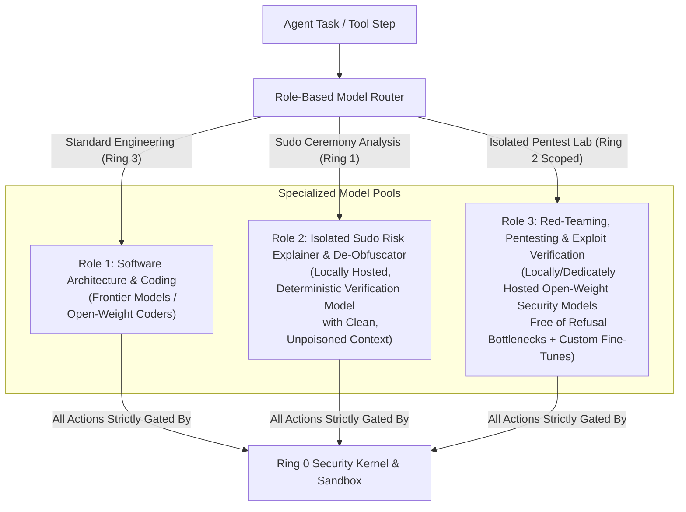

# 04 – Model Routing & Provider Security

This document outlines the minimal Python base harness architecture, the multi-model routing strategy for legitimate cybersecurity work, and the provider security boundaries that keep cloud and local inference inside Ring 0.

---

## 1. Lightweight Python Base Harness Architecture

### 1.1 Why a Minimal Trusted Computing Base (TCB) Is Essential
Large, monolithic agent frameworks with tens of thousands of lines of code and opaque plugin abstractions violate the security principle of **auditability**:
- In sprawling codebases, *Living-off-the-Land* bypasses (such as an unguarded `subprocess.Popen` call in a utility module) easily go unnoticed.
- A compact, object-oriented, strictly typed Python core guarantees that **100% of all tool executions pass through the Ring-0 `SecurityKernel`**.

### 1.2 Architectural Blueprint (`mini-swe-agent` Inspired Core + Ring-0 Kernel)

```text
ActiveSecHarness/
├── README.md
├── AGENTS.md                         # Engineering & Security Rules for Humans and AI Agents
├── .cursor/rules/                    # Automated Cursor IDE Enforcement Rules
├── docs/                             # Architectural Specifications (01 - 04)
├── wiki/                             # Self-Updating Karpathy LLM Security Wiki
│   ├── INDEX.md                      # Wiki Knowledge Graph Entry Point
│   ├── SECURITY_LEDGER.md            # Live Component Risk & Test Verification Matrix
│   ├── log.md                        # Chronological Security & Verification Log
│   ├── components/                   # Auto-Updated Per-Component Security Assessments
│   └── vectors/                      # Threat Vector Cross-Reference Pages
├── src/
│   └── activesec/
│       ├── core/                     # Immutable Ring-0 Security Kernel (TCB)
│       │   ├── exceptions.py         # Strict Security Exception Hierarchy
│       │   ├── component.py          # Base SecureComponent Contract & Self-Assessment Metadata
│       │   ├── capability_token.py   # Cryptographic Token Chain & Monotonic Attenuation
│       │   ├── taint_tracker.py      # Context-Poisoning & Prompt-Injection Tracker
│       │   └── audit_log.py          # Hash-Chained Append-Only Security Audit Log
│       ├── guards/                   # Deterministic Ring-0 Gateways
│       │   ├── archive_guard.py      # Streaming ZipBomb & Zip-Slip Protection
│       │   ├── credential_guard.py   # Entropy, De-Mangling Dictionary Check & Secret DLP
│       │   ├── network_guard.py      # TLS 1.3 Enforcement & Socket Anti-SSRF
│       │   ├── malware_guard.py      # Quarantine, Magic-Byte, ClamAV & YARA Scanner
│       │   └── sandbox_guard.py      # bubblewrap / Rootless Container / cgroups Wrapper
│       ├── sovereign/                # Ring-1 Human Interface & Social-Engineering Defense
│       │   ├── deobfuscator.py       # Base64/Hex/Script/Unicode De-Obfuscation
│       │   └── risk_explainer.py     # Context-Isolated "Explain-Before-Sudo" Evaluator
│       └── harness/                  # Ring-2 & Ring-3 Agent Execution Loop
│           ├── agent_loop.py         # Minimal Object-Oriented Agent Loop
│           ├── model_gateway.py      # Ring-0 OpenRouter & Local Ollama Gateway
│           ├── model_router.py       # Role-Based Multi-Model Router
│           └── pentest_lab.py        # Ephemeral Network/Container Lab Manager
├── tools/
│   └── wiki_sync.py                  # Automated Security Test Runner & Karpathy Wiki Compiler
└── tests/
    ├── security/                     # Dedicated Adversarial Security Tests per Component
    └── unit/                         # Functional Unit Tests
```

---

## 2. Model Strategy: Overcoming Cybersecurity Refusals Safely

Commercial cloud models frequently trigger false-positive refusals when asked to analyze exploit payloads, write penetration testing scripts, simulate dictionary attacks, or verify vulnerabilities—even for defensive engineering. Conversely, running uncensored models without a hardened harness risks host compromise.

### Architectural Containment Enables Specialized Security Models
Because **Ring 0 (deterministic guards + sandbox) and the `sudo` capability chain** enforce physical boundaries at the OS level, ActiveSecHarness does not rely on model self-censorship for host safety:



- **Strict Routing Invariant:** `ModelRouter` only permits invoking an uncensored Role-3 pentest model with active execution tools when a valid, cryptographically verified `PentestCapabilityToken` binds execution to an isolated ephemeral lab namespace.

---

## 3. Provider Security Boundaries

Model text is untrusted data. Every inference call is mediated by the Ring-0 `ModelGateway` before any tool execution:

1. **Cloud provider lock-down:** OpenRouter traffic uses TLS 1.3, is pinned to `openrouter.ai`, is restricted to an explicit model allowlist, and sends `provider.data_collection = deny` with fallbacks disabled.
2. **Local loopback only:** Ollama is accepted only at `http://127.0.0.1:11434`. Management endpoints (`/api/pull`, `/api/create`, `/api/delete`, `/api/push`, `/api/copy`) are rejected. Optional SHA-256 digest pins bind a role to a specific model blob.
3. **Pentest role binding:** A Role-3 security model may be invoked together with execution tools only when a cryptographically verified pentest capability token limits the session to an isolated lab namespace.
4. **Audit record:** Guard denials and mediated model calls are appended to the hash-chained audit log. `tools/wiki_sync.py` records component security-test status and runtime telemetry from that log.
