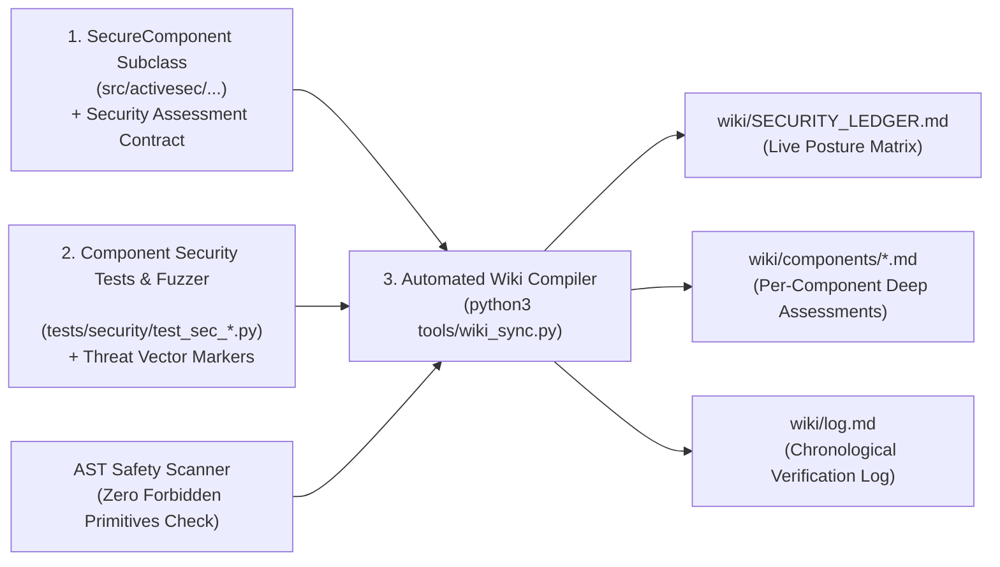

# Karpathy Security Wiki – ActiveSecHarness (`wiki/INDEX.md`)

Welcome to the **ActiveSecHarness Living Security Wiki**.

Inspired by Andrej Karpathy's **LLM Wiki** architecture, this directory is not a static documentation folder that slowly drifts out of sync with the codebase. Instead, it is a **compounding, self-verifying security knowledge graph** maintained jointly by AI agents and deterministic verification scripts (`tools/wiki_sync.py` & `tools/pre_commit_gate.py`).

---

## 1. How the Living Security Wiki Works

Every component in `ActiveSecHarness` is bound by three automated invariants:
1. **Self-Assessment Contract (`ComponentSecurityAssessment`):** Every class in Ring 0/1/2 declares its privilege ring, mitigated threat vectors (`A.1`–`F.3`), enforced deterministic invariants, known residual risks, and dedicated security test module path.
2. **Adversarial Component Security Test Suite (`tests/security/test_sec_<component>.py`):** Before any component assessment is marked `VERIFIED`, `tools/wiki_sync.py` executes its dedicated security test suite and parses the exact pass/fail results per threat vector.
3. **AST Safety Audit:** The compiler statically inspects the component's Python AST to verify the absence of forbidden unsafe primitives (`eval`, `exec`, `pickle`, `shell=True`, `extractall`, `random`).

---

## 2. Knowledge Graph Navigation

### Live Dashboards & Logs
- **[`wiki/SECURITY_LEDGER.md`](SECURITY_LEDGER.md)** — Master real-time matrix of all registered components, ring levels, AST safety checks, and adversarial security test counts.
- **[`wiki/log.md`](log.md)** — Append-only chronological record of automated security runs and wiki updates.

### Per-Component Security Assessments (`wiki/components/`)
- **[`wiki/components/audit_log.md`](components/audit_log.md)** — Ring-0 Hash-Chained Append-Only Security Audit Log (`A.3`, `F.3`).
- **[`wiki/components/capability_token.md`](components/capability_token.md)** — Ring-0 Cryptographic `sudo` Capability Token & Monotonic Attenuation Engine (`A.1`, `A.3`, `F.2`, `F.3`).
- **[`wiki/components/archive_guard.md`](components/archive_guard.md)** — Ring-0 Streaming Decompression Bomb & Path-Traversal Guard (`B.1`, `B.2`).
- **[`wiki/components/canary_guard.md`](components/canary_guard.md)** — Ring-0 Honeypot Canary & Zero-False-Positive Intrusion Tripwire (`F.2`, `C.3`, `D.2`, `A.1`).
- **[`wiki/components/credential_guard.md`](components/credential_guard.md)** — Ring-0 Entropy, De-Mangling Dictionary Attack Defense & Bidirectional Secret DLP (`D.1`, `D.2`, `D.3`).
- **[`wiki/components/malware_guard.md`](components/malware_guard.md)** — Ring-0 Malware, Magic-Byte Anti-Spoofing & Polyglot Guard (`B.3`, `B.4`, `F.2`).
- **[`wiki/components/network_guard.md`](components/network_guard.md)** — Ring-0 TLS 1.3 Enforcer & Socket-Level Anti-SSRF/DNS-Rebinding Validator (`C.1`, `C.2`, `C.3`).
- **[`wiki/components/sandbox_guard.md`](components/sandbox_guard.md)** — Ring-0 Namespace Sandbox (`bubblewrap`), Clean-Room Environment & Resource Quota Guard (`A.1`, `A.2`, `E.1`, `E.2`, `E.3`).
- **[`wiki/components/deobfuscator.md`](components/deobfuscator.md)** — Ring-1 Social-Engineering Command De-Obfuscator & Trojan-Source Detector (`B.4`, `F.1`, `A.1`).

### Threat Vector Domain Syntheses (`wiki/vectors/`)
- **[`wiki/vectors/domain_a_lotl.md`](vectors/domain_a_lotl.md)** — Domain A: Living off the Land (LotL) & Harness Self-Tampering
- **[`wiki/vectors/domain_b_artifacts.md`](vectors/domain_b_artifacts.md)** — Domain B: Decompression Bombs, Zip-Slip & Malware Ingestion
- **[`wiki/vectors/domain_c_network.md`](vectors/domain_c_network.md)** — Domain C: TLS Transport, SSRF, DNS Rebinding & Supply Chain
- **[`wiki/vectors/domain_d_credentials.md`](vectors/domain_d_credentials.md)** — Domain D: Password Entropy, Dictionary Attacks & Secret DLP
- **[`wiki/vectors/domain_e_sandbox.md`](vectors/domain_e_sandbox.md)** — Domain E: Namespace Isolation, Seccomp & Resource Limits
- **[`wiki/vectors/domain_f_cognitive.md`](vectors/domain_f_cognitive.md)** — Domain F: Human Social Engineering & Indirect Prompt Injection
